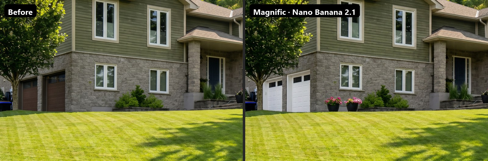
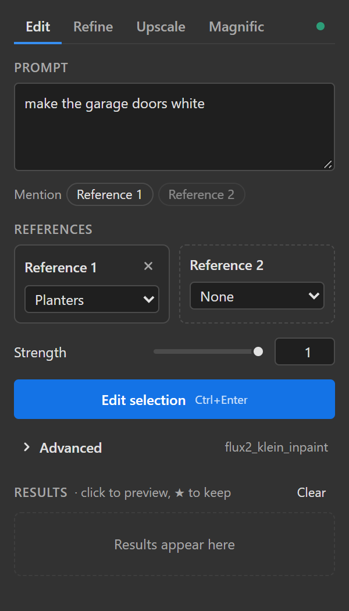
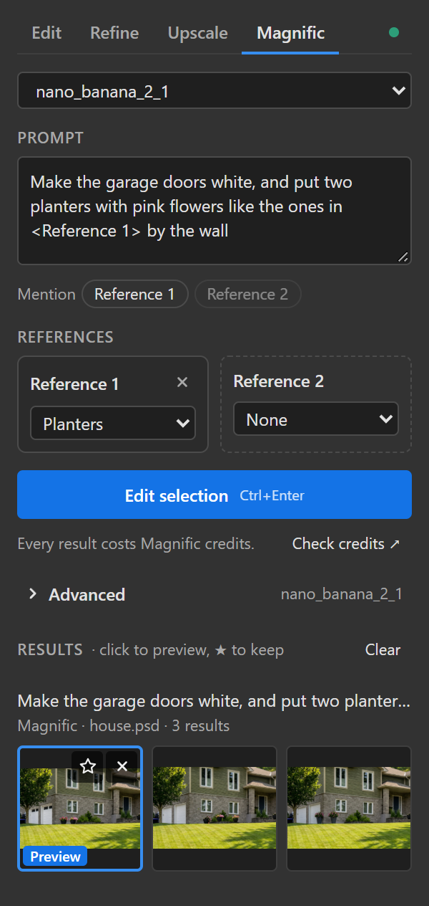
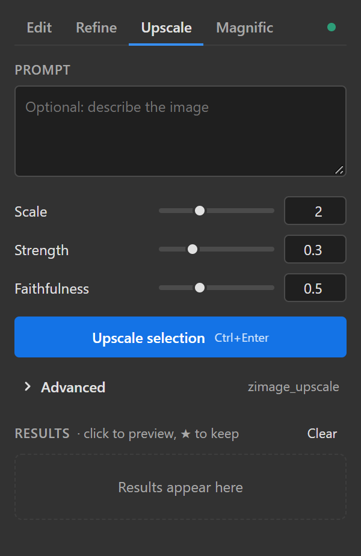
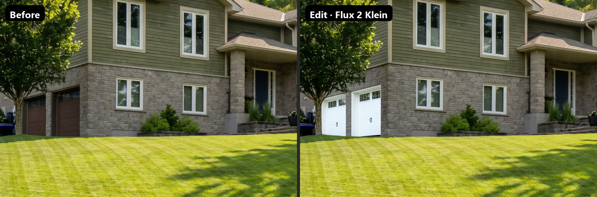
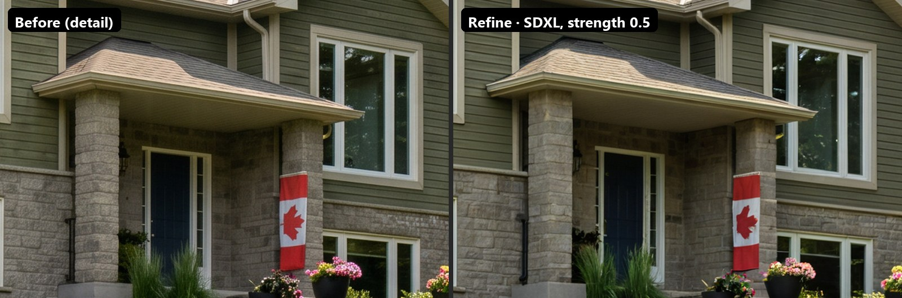
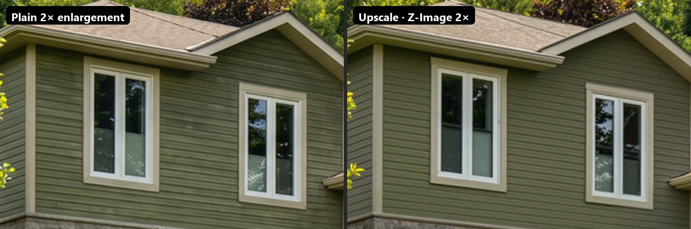

# GPC Photoshop for ComfyUI

Edit, refine and upscale inside Photoshop with your own [ComfyUI](https://github.com/comfyanonymous/ComfyUI)
workflows, or with Google's Nano Banana through a Magnific account.

Select an area, write what you want, click the button. The panel sends the selection and its
surroundings to ComfyUI, runs a workflow, and places the result back over the selection, lined up,
blended in, at full resolution.



<p>
  
  
  
</p>

## What it does

| Tab | For | Bundled template |
| --- | --- | --- |
| **Edit** | Changing what's inside a selection with an instruction ("make the garage doors white"), optionally with reference images | Flux 2 Klein 4B |
| **Refine** | Img2img: repainting a selection or the whole image while keeping its shapes | SDXL (Juggernaut XL) with a tile ControlNet, tiled automatically for big areas |
| **Upscale** | Making the whole image, or a part of it, 2–4× larger with new detail | Z-Image Turbo, tiled, with its tile ControlNet |
| **Magnific** | Editing with Nano Banana 2.1, Pro or Pro Flash (paid, online, through your Magnific API key) | No local model needed |

- Results show up as thumbnails; the first one previews in the document right away. Keep the ones you
  like as layers, discard the rest.
- Results land exactly over the area they were made for, as layers or smart objects, with soft edges.
- The panel builds its settings from the workflow itself. Any ComfyUI workflow becomes a panel template
  by adding a few small **marker nodes**, no code. See [Templates](docs/templates.md).
- No Creative Cloud app or Adobe sign-in needed: it's a classic CEP panel.

## Examples

**Edit** with Flux 2 Klein: "make the garage doors white"



**Refine** with SDXL at strength 0.5 (detail)



**Upscale** 2× with Z-Image Turbo (detail)



## Quick start

You need Photoshop 2022 (v23) or newer, on Windows or macOS, and a working ComfyUI.

1. Install the node pack into ComfyUI and restart it:
   ```bash
   cd ComfyUI/custom_nodes
   git clone https://github.com/gprzzzz/ComfyUI_GPC_Photoshop.git
   ```
2. Close Photoshop and run the panel installer from the `photoshop` folder of this repo:
   `install_windows.bat` (double-click) or `install_mac.sh` (in Terminal).
3. Start Photoshop and open **Window › Extensions (legacy) › GPC ComfyUI**. The dot at the top right turns
   green when the panel reaches ComfyUI at `http://127.0.0.1:8188`.
4. Get the models for the templates you want to use. The panel tells you what's missing.

The [install guide](docs/install.md) has the details: models and node packs per template, another
ComfyUI address, the Magnific key, updating and troubleshooting.

## Guides

- [Install](docs/install.md): ComfyUI side, Photoshop side, models, Magnific, troubleshooting
- [Usage](docs/usage.md): each tab, references, results, settings, tips
- [Templates](docs/templates.md): how the bundled workflows work, making your own, the marker nodes,
  comparing settings without Photoshop, developing

## License

[GPL-3.0](LICENSE). The bundled workflows follow the graphs of
[Krita AI Diffusion](https://github.com/Acly/krita-ai-diffusion), rebuilt for Photoshop. Not affiliated
with Adobe, Magnific, Google or Black Forest Labs; Nano Banana, Photoshop and the model names belong to
their owners.
