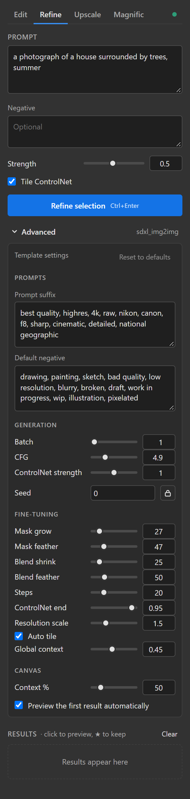

# Usage


## The basics

1. **Pick a tab:** Edit, Refine, Upscale or Magnific. A tab with more than one template shows a picker
   under the tabs; each tab remembers the one you used last.
2. **Select** the area to change, with any selection tool. Feathered selections stay soft. Refine,
   Upscale and Magnific also work on the whole image when nothing is selected (the button says
   *selection* or *image*).
3. **Write the prompt.** For Edit and Magnific, say what to change: "make the garage doors white". For
   Refine, describe the whole picture: "a photograph of a house surrounded by trees".
4. Click the button, or press **Ctrl+Enter** in the prompt.
5. Results appear as **thumbnails**, and the first one shows in the document as a temporary
   **GPC preview** layer. Click a thumbnail to preview that one instead, and click it again to hide it.
6. Click **★** to keep a result as a layer, **×** to discard it. **Clear** forgets all thumbnails; layers
   you kept stay.

The panel uses the visible image (all layers merged), plus some of the surroundings around your
selection (**Context %** under Advanced) so the model sees what's around it. Results always go back to
the document they were made for, even if you switch documents while ComfyUI works.

Results live in the panel until you click Clear or close it; they aren't saved in your document unless
you keep them.

<br clear="right">

## Settings



The main settings sit above the button (Strength, for example). Everything else is under **Advanced**:

- **Hover a setting's name** to see what it does.
- Settings are remembered **per template**. One that differs from the template's default gets a blue dot;
  **Reset to defaults** puts them all back (your prompts stay).
- **Seed** is random for each run. Lock it (the padlock) to repeat a result while you change something
  else.
- **Batch** is how many results one run makes.
- **Context %** is how much of the surroundings goes along with the selection, as a share of its longest
  side. Each tab remembers its own (50% by default, 10% on the Magnific tab).
- **Preview the first result automatically** can be turned off if you'd rather click.

## References

Edit and Magnific have **reference slots**: pick a layer of the document or an image file in a slot,
then mention it in the prompt with the **Mention** buttons, or by typing its name in angle brackets:

```
Add flowers like the ones in <Reference 1> by the front steps
```

The models number their input images (the area you selected is image 1); the panel swaps each mention
for the right number before sending.

<br clear="right">

## Edit (Flux 2 Klein)

For changes described in words: recolor, replace, add or remove things inside the selection.


- **Strength** 1 replaces the selection; lower keeps more of what's there.
- Under Advanced: **Mask grow / feather** set how far around the selection the model may paint, and
  **Blend shrink / feather** how softly the result fades into the document.

## Refine (SDXL)

Img2img: SDXL repaints the selection (or the whole image) while a tile ControlNet keeps its shapes. Good
for adding realism, texture and light to a rough render or a weak area.


- **Strength** is how much it repaints: 0.3 polishes, 0.6 reworks, 1 starts over.
- **Tile ControlNet** keeps shapes in place. Leave it on above strength ~0.5, otherwise SDXL redraws the
  scene freely.
- **Auto tile** (Advanced, on) splits big areas into overlapping tiles automatically, so a large
  selection keeps full detail instead of being shrunk and stretched back. Small selections take a few
  seconds; a 2048 px area about a minute.
- **ControlNet end** (0.95) leaves the last steps free so fine texture comes out crisp. Lower lets SDXL
  invent more detail of its own.
- For soft vegetation, try Strength 0.75 with **ControlNet strength** (Advanced) at 0.6: the shapes stay,
  and SDXL is free to draw new leaves.

## Upscale (Z-Image Turbo)

- **No selection:** the whole image is upscaled and opens as a **new document**.
- **A selection:** just that part is upscaled and placed back over it as a **smart object** holding the
  full-size pixels; ★ keeps it as a smart object.
- **Scale** (2×), **Strength** (0.3: how much new detail it adds; above ~0.35 it starts inventing small
  objects) and **Faithfulness** (0.5: how closely it follows the original) are above the button.
- Tiny symbols and lettering (a flag's emblem, a sign) can come out changed, especially from a small
  source image. Lower **Strength** to 0.2 for those, or keep the original there with a layer mask.


## Magnific (Nano Banana)


Edits with Google's Nano Banana models through your Magnific API key (see the
[install guide](install.md#4-magnific-optional)). The template picker chooses the model:


| Template | Model | Credits per result (Oct 2026) |
| --- | --- | --- |
| `nano_banana_2_1` | Nano Banana 2.1, the newest | 50 at 1K, 65 at 2K |
| `nano_banana_pro` | Nano Banana Pro | 75 |
| `nano_banana_pro_flash` | Nano Banana Pro Flash ("Nano Banana 2" on Magnific's site), the fastest | 75 |

What happens when you click **Edit selection**:

1. The area grows to the nearest aspect ratio Nano Banana makes (1:1, 3:2, 16:9, …), so you don't have
   to match ratios yourself.
2. It's sent at **1K** or **2K**: Pro and Pro Flash always use 2K (their 1K costs the same); 2.1 uses 1K
   for areas up to about a megapixel, else 2K. The progress line says which.
3. Results arrive **one by one** as Magnific finishes them, typically 15 seconds to a few minutes each.
4. Each result is placed as a **smart object** holding Nano Banana's whole frame at full resolution,
   lined up with the document, with an ordinary **layer mask** from your selection. Paint the mask to
   show more or less of the result, right up to the frame's edge. Turn off **Blend into selection** for
   an all-white mask.
5. A **batch** becomes **one smart object** holding every result (layers *Result 1, 2, …*, one visible).
   Click a thumbnail to show that result in it; ★ keeps the smart object showing that one, with the others
   still inside.

Good to know:

- **Batch** is 1 by default: each result is a separate paid request.
- **Cancel** stops waiting, but Magnific still finishes the results and charges for them.
- Magnific sometimes refuses a request for a moment ("Error consuming credits", even with credits to
  spare). The node retries twice; if it's still refused, the results already started still come back,
  with a note.
- **Check credits ↗** under the button opens your Magnific API keys page, which shows your balance.
- Nano Banana has no seed: each run differs.

<br clear="right">

## Tips

- **Small, focused selections** give the model more pixels to work with. Edit and Magnific upscale
  small areas before generating and scale the result back.
- **Smart object results** (Upscale, Magnific) keep their full resolution: scale them later without loss.
- **Template files** live in this repo's `templates/` folder. To change a default (a checkpoint, a
  strength), copy one into `ComfyUI/user/gpc_photoshop/` under the same name and edit it there; your
  copy wins, and updates won't overwrite it. See [Templates](templates.md).
